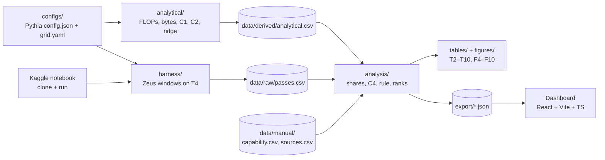

# Design: Energy Anatomy Profiling and Analysis Repo

Status: **all design decisions closed** (2026-10-14). Repo: scienseize/energy-anatomy. Starting spec for the Claude Code build; Section 11 records each decision.

## 1. Purpose

One repo produces every number in Chapter III. It covers Chapter II Phases 2 (anatomy), 3 (profiling), 4 (diagnosis), 6 (substitution evaluation) and the Phase 7 export, and writes Tables T2–T10 and Figures F4–F10 (see the execution plan). Phase 1 (screening) and the capability evidence are curated by hand and enter as CSVs.

Locked inputs (execution plan, "Decisions locked"):

- GPU: Kaggle T4 (16 GB, 320 GB/s, 8.1 TFLOPS FP32 without tensor cores, 65 TFLOPS FP16 tensor, 4 MB L2, 70 W cap)
- Energy: Zeus `ZeusMonitor` (NVML energy counter)
- Models: Pythia 160M, 1.4B, 6.9B; seq 512, 1024, 2048; FP32, FP16; 8,192 tokens per pass → 18 configs
- Denominator: measured full block × layers + embedding lookup + final norm + output projection
- Components: embed_lookup, ln, attn_proj, rope, attn_core, mlp, final_ln, out_proj, loss
- Substitutions: sdpa_core, linear_core, gqa_proj, factorized_embed, rmsnorm

## 2. Architecture



Two run locations:
- **Mac (CPU or MPS)**: analytical model, analysis, tables, figures, tests, and dry runs of the harness on tiny dims. No energy numbers come from the Mac.
- **Kaggle T4**: only `anatomy profile`. The notebook clones the repo, installs it, runs profiling with resume, and saves `data/raw/` as notebook output.

## 3. Repo layout

```
energy-anatomy/                 # github.com/scienseize/energy-anatomy (public)
├── pyproject.toml
├── configs/
│   ├── pythia/                 # HF config.json for 160m, 1.4b, 6.9b (no weights)
│   ├── grid.yaml               # sizes × seq × precision, tokens_per_pass
│   ├── hardware/t4.yaml        # peak FLOPs per precision, bandwidth, L2
│   └── protocol.yaml           # warmup, passes, min window, buffer rotation
├── src/anatomy/
│   ├── config.py               # load + validate configs → ModelSpec, RunSpec
│   ├── components/             # one nn.Module per component, GPT-NeoX semantics
│   │   ├── embed.py  ln.py  attn_proj.py  rope.py  attn_core.py  mlp.py  out_proj.py
│   │   └── block.py            # full parallel-residual decoder block (denominator)
│   ├── substitutions/
│   │   ├── sdpa_core.py  linear_core.py  gqa_proj.py  factorized_embed.py  rmsnorm.py
│   ├── analytical/
│   │   ├── counts.py           # FLOPs and bytes per component, fwd + bwd
│   │   └── roofline.py         # C1, ridge point, memory-bound flag, predicted time
│   ├── harness/
│   │   ├── buffers.py          # rotating input sets (> L2)
│   │   ├── measure.py          # warmup, repetition loop, Zeus window, per-pass record
│   │   └── runner.py           # iterate grid, resume from passes.csv
│   ├── analysis/
│   │   ├── shares.py           # C2, C3 per component per config
│   │   ├── waste.py            # C4, rankings, rank shifts across C5
│   │   ├── hypothesis.py       # decision rule → T6
│   │   ├── capability.py       # ordinal overlay from data/manual/capability.csv
│   │   ├── substitutions.py    # RQ5 deltas → T10
│   │   └── validate.py         # analytical vs profiled → T4
│   ├── report/
│   │   ├── tables.py           # CSV + Markdown for T2–T10
│   │   └── figures.py          # matplotlib PNG/SVG for F4–F10
│   ├── export.py               # JSON for the dashboard
│   └── cli.py                  # `anatomy ...`
├── notebooks/kaggle_profile.ipynb   # thin: clone, pip install, anatomy profile --resume
├── data/
│   ├── raw/passes.csv          # append-only, one row per measured pass
│   ├── manual/capability.csv  sources.csv
│   └── derived/  tables/  figures/  export/
└── tests/
```

## 4. Components (baseline)

Built from Pythia's HF `config.json` (`hidden_size`, `num_attention_heads`, `num_hidden_layers`, `intermediate_size`, `rotary_pct`, `vocab_size`), with random weights. Energy doesn't depend on trained weight values beyond small data-dependent power effects, which go in as a stated limitation. Each module mirrors GPT-NeoX semantics, and a test checks the summed parameter count against the published size.

| Component | What runs (fwd + bwd) | Roofline class expected | H1 test? |
|---|---|---|---|
| embed_lookup | `Embedding(vocab, d)` gather | memory | yes |
| ln | one LayerNorm (×2 per block, parallel residual) | memory | yes |
| attn_proj | fused QKV `Linear(d, 3d)` + output `Linear(d, d)` | compute | no (reported) |
| rope | rotary on `rotary_pct` of head dims for Q and K | memory | yes |
| attn_core | QKᵀ, causal mask, softmax, ·V as eager ops (decided) | memory at long seq | yes |
| mlp | `Linear(d, 4d)`, GELU, `Linear(4d, d)` | compute | no (reported) |
| final_ln | LayerNorm once per model | memory | yes (pooled with ln) |
| out_proj | `Linear(d, vocab)` logits | compute | no (reported) |
| loss | cross-entropy (softmax over logits) fwd + bwd | memory | no (reported; outside the five named components) |
| block | full parallel block: `x + attn(ln1(x)) + mlp(ln2(x))` | — | denominator |

Per config, model energy is E_total = L · E_block + E_embed + E_final_ln + E_out_proj + E_loss. Component energy is E_c · (count per model), and Unattributed is E_total − Σ components.

## 5. Substitutions

Each substitution replaces exactly one component, and is profiled at every grid config the same way as its baseline.

| Substitution | Replaces | Implementation | Parameter |
|---|---|---|---|
| sdpa_core | attn_core | `F.scaled_dot_product_attention`, mem-efficient backend forced (FA2 unsupported on T4) | — |
| linear_core | attn_core | Katharopoulos et al. (2020), φ(x) = elu(x)+1, causal via cumulative sums | — |
| gqa_proj | attn_proj | K and V projections with fewer heads | kv heads = heads/4 (3, 4, 8) |
| factorized_embed | embed_lookup + out_proj | ALBERT style: `Embedding(vocab, E)` + `Linear(E, d)`, mirrored at output | E = 128 (Lan et al., 2020) |
| rmsnorm | ln, final_ln | Zhang & Sennrich (2019) RMSNorm | — |

RQ5 metric: ΔE_model = E_total(baseline) − E_total(with substitution), as % of baseline, per config. The substitution's own component energy is reported too.

## 6. Measurement protocol (harness)

For each (config, unit), where unit ∈ components ∪ substitutions ∪ {block}:

1. Build the module at the config's precision on `cuda`. Allocate **K rotating input sets** so their total size exceeds 4 MB × 4 (K ≥ 2, computed per unit). Use matching `grad_output` tensors.
2. **Warm-up**: run W fwd+bwd iterations (default 20) and discard them.
3. **Calibrate repetitions R** so that one measured window lasts ≥ T_min (default 2 s), since the NVML counter updates far more slowly than layer norm runs (Jain et al., 2025 amplification).
4. **Measure N passes** (default 10). Each pass: `torch.cuda.synchronize()` → `monitor.begin_window()` → R × (forward on buffer i mod K, `backward(grad_output)`, `param.grad = None`) → `synchronize()` → `end_window()`. Record energy_J, time_s, energy per rep = energy_J / R, and avg power.
5. Record context per pass: GPU clocks (SM, mem), temperature, power limit, torch/CUDA versions, and a throttle flag if clocks drop more than 10% from pass 1. *Revised 2026-10-16 (decision 17): clocks, temperature and NVML throttle reasons are sampled every 0.1 s during the window, and `throttled` is judged against the GPU's maximum SM clock.*
6. **Idle baseline**: a 10 s idle window at session start and every 30 min. Shares use **total** energy; dynamic shares (total − idle power × window time) are computed as a sensitivity check (appendix table).

Kaggle constraints: there's no root, so clocks can't be locked. Clocks are recorded instead, and throttled passes are flagged, not dropped. Sessions end after 12 h, so the runner appends each pass to `passes.csv` immediately and `--resume` skips (config, unit, pass) rows already done. A CUDA OOM on any unit is logged as `status=oom` and skipped, never silently dropped.

Estimated budget: 18 configs × (8 units + 5 substitutions + block) × N=10 × ~3 s, plus warm-up and calibration ≈ 4–6 GPU hours. That leaves headroom within Kaggle's 30 h/week to rerun.

## 7. Analytical model

- **FLOPs** per component, fwd + bwd (bwd ≈ 2× fwd for matmuls, and counted explicitly for norms, softmax, RoPE and gathers). Matmul FLOPs = 2·m·n·k.
- **Bytes** = reads + writes of activations, weights and gradients at the config's precision, assuming no cache reuse between kernels (upper bound). This assumption is stated, and it matches the buffer rotation.
- **C1** = FLOPs / bytes. **Ridge point** from `t4.yaml`: FP32 = 8.1 TFLOPS / 320 GB/s ≈ 25 FLOP/B, FP16 (tensor) ≈ 203 FLOP/B. Matmuls use the tensor-core peak only in FP16. Elementwise ops use the CUDA-core peak.
- **Memory-bound** if C1 < ridge for that config. This flag decides which component–config pairs enter the H1 test (Ch. II).
- **C2** = FLOPs_c × count / total FLOPs.
- **Analytical energy estimate** for validation (T4) and for any unprofiled extension configs: t̂_c = max(FLOPs/peak, bytes/BW). The share comes from t̂ weighted by the measured average power of its roofline class.

## 8. Analysis

| Output | Module | Content |
|---|---|---|
| T2 | config | the 18 configs with profiled flag |
| T4 | validate | analytical vs measured C3, abs diff, rank agreement (Spearman ρ, descriptive) |
| T5 | shares | C1, C2, C3 median, C3 IQR per component per config, plus Unattributed |
| T6 | hypothesis | per testable component: configs where memory-bound, configs with C4 > 0 and C4 > IQR, verdict |
| T7 | waste | C4 per component per config, rank |
| T8 | capability | ordinal capability rank + evidence citation (from manual CSV) |
| T9 | substitutions | priority component → mechanism → substitution → source (semi-manual) |
| T10 | substitutions | baseline vs substitution E_total, Δ%, published value |
| F5–F10 | figures | paired bars, roofline scatter, diverging C4, waste × capability quadrant, rank-shift heatmap, Δ% bars |

**C3 per pass**: shares are computed per pass index (pass j of every unit in a config, as one matched set), which gives N values of C4. The median is the point estimate and the IQR across passes is the spread the decision rule uses. This is what makes "gap exceeds the IQR" computable.

**Decision rule** (Ch. II, plus the attention split): a component is supported if, among profiled configs where it is memory-bound, a majority have median C4 > 0 **and** median C4 > IQR(C4). The embedding lookup and attn_core enter the test, while attn_proj, mlp and out_proj are reported only. ln and final_ln are pooled and tested as one "layer normalization" component (decided).

Sanity outputs written alongside: Σ C2 = 1, Σ C3 + Unattributed = 1, Σ C4 over components = −Unattributed share. Plus energy per FLOP per component, which guards against the C2 ≈ 0 artifact.

## 9. Data schemas

`data/raw/passes.csv` (append-only):
`run_id, ts, model, seq_len, precision, tokens, unit, unit_kind{component|substitution|block}, pass_idx, reps, energy_j, time_s, energy_per_rep_j, avg_power_w, sm_clock_mhz, mem_clock_mhz, temp_c, power_limit_w, throttled, throttle_reasons, status{ok|short_window|oom}, torch, cuda, driver, gpu_uuid, git_sha` (`power_limit_w` added 2026-10-16, decision 16; `throttle_reasons` added 2026-10-16, decision 17)

`data/raw/idle.csv`: `run_id, ts, energy_j, time_s, avg_power_w, sm_clock_mhz, mem_clock_mhz, temp_c, power_limit_w, throttle_reasons, gpu_uuid` (decision 15)

`data/derived/analytical.csv`: `model, seq_len, precision, component, count_per_model, flops, bytes, c1, ridge, memory_bound, c2, t_hat`

`data/derived/shares.csv`: `model, seq_len, precision, component, pass_idx, c3, c4`, with summary `c3_med, c3_iqr, c4_med, c4_iqr`

`data/manual/capability.csv`: `component, capability_rank, evidence, citation, note`

`export/` JSON (dashboard): `configs.json`, `profile.json` (C2, C3 per component per config), `ranking.json` (C4 + capability), `meta.json` (git sha, date, GPU). Values come straight from `derived/`, so the dashboard computes nothing (Phase 7).

## 10. Testing

- **Counts**: summed module parameters match each Pythia size within 1%. FLOP counts for a matmul and LayerNorm are checked by hand.
- **Invariants**: shares sum to 1; C4 sums to −Unattributed; a ranking is invariant to row order.
- **Decision rule**: table-driven cases (majority boundary, IQR boundary, component not memory-bound anywhere → "not tested").
- **Harness dry run**: on CPU with a fake monitor, the full grid at tiny dims runs end to end and resume skips completed rows.
- **HF equivalence**: our block matches HF `GPTNeoXLayer` output within tolerance for copied weights (160M dims, CPU).
- **Substitution equivalence**: sdpa_core matches attn_core outputs within tolerance, and rmsnorm/LN shapes match.
- **Kaggle smoke test** (first session, about 10 min): Zeus reads nonzero energy on the T4, one 160M config completes, and passes.csv downloads.

## 11. Open questions (to ask one at a time)

1. ~~Baseline attn_core implementation~~ **Decided: eager ops** (explicit matmul, mask, softmax, matmul; GPT-NeoX eager path).
2. ~~Static power~~ **Decided: total energy for shares; dynamic shares as appendix check.**
3. ~~Cross-entropy~~ **Decided: own reported row (`loss`), not tested.**
4. ~~GQA kv heads, factorized rank~~ **Decided: kv heads = heads/4; E = 128.**
5. ~~Protocol numbers~~ **Decided: N = 10 passes, T_min = 2 s, W = 20 warm-up.**
6. ~~Hosting, Python, deps~~ **Decided: public GitHub, uv (lockfile), Python 3.11; Kaggle runs `pip install -e .`.** Repo: scienseize/energy-anatomy.
7. ~~Own vs HF modules~~ **Decided: own minimal modules; test full-block output equals HF GPTNeoXLayer for identical weights (transformers as a test-only dependency).**
8. ~~LN pooling~~ **Decided: ln + final_ln pooled as one component (RQ1.3).**
9. ~~FP16 mode~~ **Decided (2026-10-15): pure `.half()`** (params, activations, softmax, LN, loss in fp16; matches Pythia's GPT-NeoX/DeepSpeed fp16), no autocast.
10. ~~Peak for mixed components~~ **Decided (2026-10-15): effective peak** P_eff = F / Σ(F_k/P_k); ridge = P_eff/BW; t̂ = max(F/P_eff, B/BW).
11. ~~linear_core chunk size~~ **Decided (2026-10-15): C = 64.**
12. ~~factorized_embed bias~~ **Decided (2026-10-15): no bias** on either projection.
13. ~~Run order~~ **Decided (2026-10-16): config-major, smallest model first** (all units of a config before the next).
14. ~~R calibration~~ **Decided (2026-10-16): one timed probe** (≥ 0.2 s), R = ceil(1.1 × T_min / t_rep); windows still < T_min get `status=short_window`.
15. ~~Idle storage~~ **Decided (2026-10-16): separate `data/raw/idle.csv`.**
16. ~~Power limit column~~ **Decided (2026-10-16): add `power_limit_w` to passes.csv.**
17. ~~Throttle detection~~ **Decided (2026-10-16, after the smoke test): sample NVML every 0.1 s in each window; record mean clocks, max temperature and the OR of clocks-event reasons (`throttle_reasons`); `throttled` = mean SM clock < 90% of the max SM clock.** The smoke test showed the T4 at its 70 W cap in every unit, with pass 0 already throttled.
18. ~~Cool session start~~ **Decided (2026-10-16): thermal pre-conditioning** at session start (matmuls until temperature changes by < 1 C over 30 s, at most 5 min), then the idle window.
19. ~~Smoke data~~ **Decided (2026-10-16): kept in `data/raw/smoke/`**, separate from the real run (earlier schema; see docs/methods.md section 12).
20. ~~Configs split across sessions~~ **Decided (2026-10-16, after the second smoke test showed -16% absolute energy between sessions with stable shares): never split a config.** On `--resume`, a config left incomplete by an earlier session is remeasured in full; analysis uses, per config, the one run id covering every unit and pass.
21. ~~GPU identity~~ **Decided (2026-10-16): add `gpu_uuid` (NVML UUID) to passes.csv and idle.csv.**
22. ~~Second smoke run~~ **Decided (2026-10-16): kept in `data/raw/smoke-2/`** (current schema except `gpu_uuid`).
23. ~~IQR method~~ **Decided (2026-10-17): linear (Hyndman-Fan type 7) quantiles**, numpy's default.
24. ~~T4 measured C3~~ **Decided (2026-10-17): renormalized over the 8 components** (the analytical model has no Unattributed term).
25. ~~Idle power for dynamic energy~~ **Decided (2026-10-17): the nearest preceding idle window** in the same session.
26. ~~Short window in substitution analysis~~ **Decided (2026-10-17): keep the one 1.991 s pass, flagged**; no matched set dropped.
27. ~~RMSNorm implementation~~ **Decided (2026-10-17): add `rmsnorm_fused` (F.rms_norm, fused kernel where the build has one) next to the eager `rmsnorm`, and rerun the full grid in one new session.** The eager version cost 0.5-4.4% more model energy than fused LayerNorm in all 18 configs, an implementation effect (about 6x the bytes). The rerun becomes the main dataset; the first full run is kept as a repeatability check. Done 2026-10-17: run 2 in `data/raw/`, run 1 in `data/raw/run-1/` (docs/methods.md sections 13 and 17).
28. ~~C5 in "rank shifts across C5"~~ **Decided (2026-10-17, tentative: Bill's recollection of the original intent): C5 = precision.** F9 is then a heatmap of rank(C4, FP16) - rank(C4, FP32) per component (rows) and model x sequence length (columns).
29. ~~capability_rank direction~~ **Decided (2026-10-17): 1 = most capable.**
30. ~~F8 quadrant split~~ **Decided (2026-10-17): waste at C4 = 0, capability at its median rank; one median C4 per component pooled over the 18 configs.**

Implementation notes (how the code realizes the above; full detail in `docs/methods.md`): FLOPs and bytes are traced per ATen op on the meta device rather than hand-enumerated; the Section 3 layout is collapsed to one file each for components, substitutions, analytical, harness and report, plus `units.py` as the shared unit registry.

## 12. Build order (maps to plan dates)

| Dates | Milestone |
|---|---|
| Oct 15 | Scaffold, configs, components, analytical model + tests → T2, C1/C2 columns, F6 |
| Oct 16 | Harness + fake-monitor dry run on the Mac; Kaggle notebook; T4 smoke test |
| Oct 16–18 | Full profiling run on Kaggle (baseline + block + substitutions), resumable |
| Oct 18–19 | Analysis: shares, validation, C4, decision rule → T4–T7, F5, F7 |
| Oct 19–20 | Capability CSV in, quadrant + rank shifts → T8, F8, F9 |
| Oct 20–22 | Substitution analysis → T9, T10, F10; export JSON |
| Oct 26–28 | Dashboard reads `export/` |
